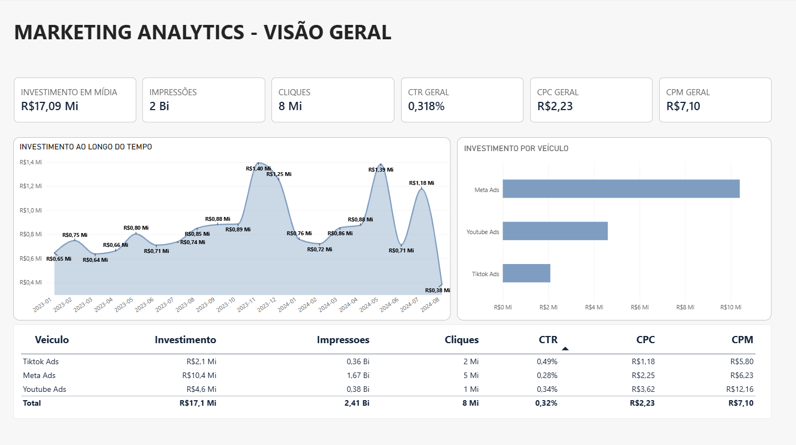
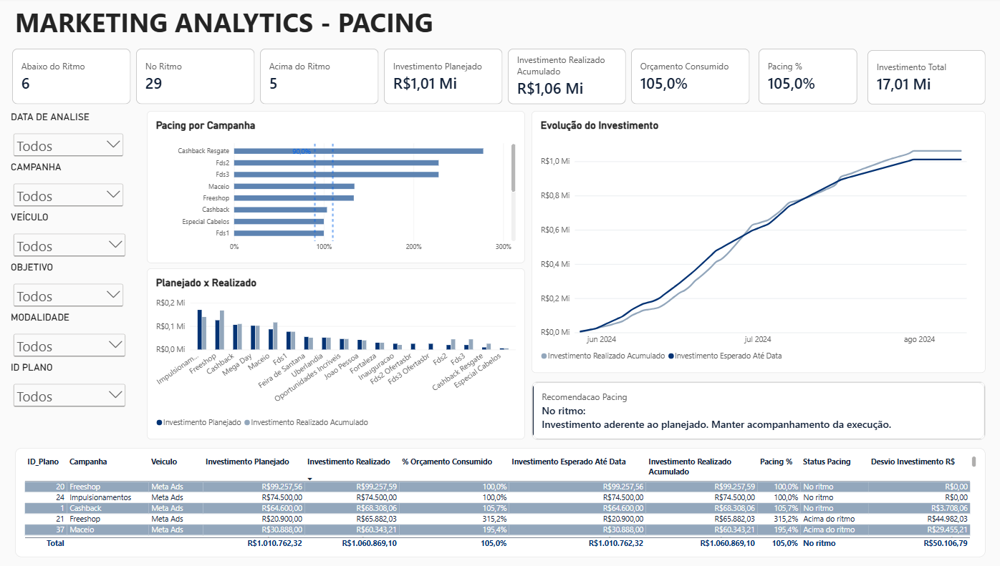

# Marketing Analytics | Power BI

## Sobre o projeto

Este projeto foi desenvolvido com o objetivo de analisar o desempenho de campanhas de marketing digital por meio de indicadores e visualizações no Power BI.

O dashboard reúne uma visão executiva dos resultados, permitindo acompanhar investimentos, comparar o desempenho entre plataformas e identificar oportunidades de melhoria.
## Visualização dos Dashboards

### 1. Visão Geral — Marketing Analytics

### 2. Análise de Pacing

## Objetivos

- Centralizar os principais indicadores de marketing em um único dashboard.
- Analisar a distribuição dos investimentos entre plataformas.
- Comparar investimentos e resultados das campanhas.
- Acompanhar o Pacing, identificando diferenças entre valores planejados e realizados.
- Facilitar a interpretação dos dados e apoiar a tomada de decisões.

## Indicadores analisados

- **Investimento:** Valores destinados às campanhas de marketing.
- **Impressões:** Quantidade de vezes que os anúncios foram exibidos.
- **Cliques:** Interações dos usuários com os anúncios.
- **CPC:** Custo médio por clique.
- **CPM:** Custo por mil impressões.
- **CTR:** Taxa de cliques em relação às impressões.
- **Pacing:** Acompanhamento dos investimentos em relação ao planejamento.

## Plataformas analisadas

- Meta Ads
- TikTok Ads
- YouTube Ads

## Ferramentas utilizadas

**Power BI:** Desenvolvimento dos dashboards e visualizações.

**Power Query:** Preparação, transformação e tratamento dos dados.

**DAX:** Criação de medidas e indicadores para análise dos resultados.

## Principais análises

O projeto permite comparar o volume de investimentos com os resultados alcançados em cada plataforma, avaliando indicadores como impressões, cliques, CPC e CPM.

Também possibilita identificar diferenças no desempenho entre os canais e acompanhar os desvios entre os investimentos planejados e realizados.

## Como visualizar o projeto

O arquivo `Marketing_Analytics.pbix` está disponível neste repositório.

Para visualizar o dashboard completo, faça o download do arquivo e abra utilizando o Power BI Desktop.
